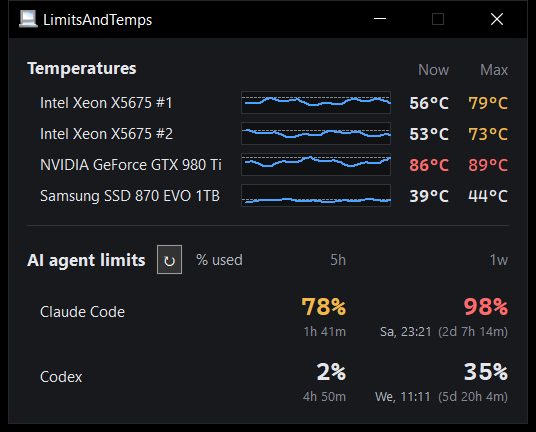

# LimitsAndTemps

A tiny tray app for Windows that shows your **AI agent usage limits** (Claude Code, Codex) and your **hardware temperatures** (CPU, GPU, drives) in one small dark window, with history sparklines and max-since-start.

It is a single `LimitsAndTemps.exe`: no installer, no DLLs, no runtime to install. It uses about 7 MB of RAM and practically no CPU, and it does nothing while it sits in the tray.



> ## ⚠️ Experimental – use at your own risk
>
> This app is **experimental** and is **not affiliated with or endorsed by Anthropic, OpenAI or any other provider**.
>
> To show your limits it reads the sign-in your coding agents already keep on your PC and calls the providers' own (undocumented, unofficial) usage endpoints, or it hooks into Claude Code's status line. Providers can change those endpoints at any time, and their terms of service may not allow this kind of use.
>
> **You are solely responsible for using this app.** If a provider restricts, suspends or bans your account because of it, that is your risk. Read your provider's terms and decide for yourself before using it.
>
> The optional CPU temperature feature installs a signed kernel driver ([PawnIO](https://pawnio.eu/)) and needs administrator rights. Enable it only if you understand and accept that.

## Features

### 1. AI agent limits

- One row per installed agent (**Claude Code**, **Codex**) with one column per limit: **5-hour**, **weekly**, and Claude's separate weekly Fable limit when reported.
- Reset times for each limit, with a countdown.
- The agents present usage in percent differently: one shows how much you have **used**, the other how much is **left**. LimitsAndTemps uses only one of these methods for all agents so the values are comparable, **% used** by default. Click the "% used" / "% left" label next to the refresh button to switch to the other method (*remaining*); the tray tooltip follows, and the choice is remembered.
- Colours turn amber and red as a limit fills up.
- Refreshes about once a minute while the window is visible, every 15 minutes while hidden, plus a manual refresh button.

### 2. Temperatures

- **CPUs**: Intel (Core 2 up to current), AMD Zen and older AMD (Phenom, FX, A-series). Multi-socket systems get one reading per CPU.
- **GPUs**: any vendor, multiple GPUs supported. Reads the same sensor Task Manager uses.
- **Drives**: NVMe/SATA temperatures. Spun-down drives are never woken up.
- Sparkline of the last 3 minutes and the maximum since start for every sensor.

### Also

- Tray icon with a tooltip summary; closing the window hides it to the tray.
- Always dark, one instance per user.
- Works on old hardware (e.g. older dual-socket Xeons).

## Install

**System requirements:** Windows 10, 64-bit (tested). Older Windows versions may work but are untested; the GPU temperature source needs a WDDM 2.4+ driver (Windows 10 1903+), and NVIDIA GPUs with older drivers fall back to NVML.

1. Download `LimitsAndTemps.exe` from the [Releases](../../releases) page (or build it yourself, see below).
2. Put it anywhere you like and run it. Use `LimitsAndTemps.exe --tray` to start it hidden in the tray, for example from your Startup folder.

That's all. GPU, drive and agent-limit readings need no admin rights.

### CPU temperature (optional)

CPU temperatures need a kernel driver, so they are off until you enable them:

1. Choose **Enable CPU temperature** in the tray menu and confirm the dialog.
2. Accept the one-time UAC prompt. The app installs the official signed [PawnIO](https://pawnio.eu/) driver if it is missing, copies itself to `%ProgramFiles%\LimitsAndTemps\` and registers a scheduled task so later starts don't prompt again.
3. To undo this, choose **Disable CPU temperature** in the tray menu (one UAC prompt). It removes the task and the copy. The PawnIO driver can be uninstalled like any other program.

After you replace the exe with a newer version, the next start asks for UAC once more to refresh the copy.

### Build from source

Needs: Windows, Git, Visual Studio with the "Desktop development with C++" workload (MSVC x64, Windows SDK, CMake, Ninja), internet on the first build.

```
git clone https://github.com/<your-account>/LimitsAndTemps.git
```

1. **wxWidgets (once):** get the latest [wxWidgets](https://github.com/wxWidgets/wxWidgets) release (with submodules) and build `wxcore` as a **static library with the static runtime (`/MT`)**, in an *x64 Native Tools Command Prompt for VS*. The default prebuilt `/MD` libraries must not be used, or the exe would need the Visual C++ runtime DLLs.
   ```
   cmake -S . -B build_mt -G Ninja -DCMAKE_BUILD_TYPE=Release -DwxBUILD_SHARED=OFF -DwxBUILD_USE_STATIC_RUNTIME=ON -DwxBUILD_SAMPLES=OFF -DwxBUILD_TESTS=OFF -DwxBUILD_DEMOS=OFF
   cmake --build build_mt --target wxcore
   ```
2. **App:** in the same prompt, in the cloned folder:
   ```
   set wxwin=<path to your wxWidgets folder>
   build.bat
   ```
   Result: `build\LimitsAndTemps.exe`.

Notes:
- `build.bat` expects the wx libraries in `%wxwin%\build_mt\lib\vc_x64_lib`. If your wx version names them differently (e.g. `wxmsw33u_core.lib`), or CMake puts them elsewhere, edit `WXLIB` and the library list in `build.bat`.
- Outside a Native Tools prompt `build.bat` calls a fixed `vcvars64.bat` path; edit it to match your Visual Studio.
- The first run downloads the official PawnIO installer and modules to `third_party\` and verifies pinned SHA-256 hashes.
- Check the result with `dumpbin /dependents build\LimitsAndTemps.exe` (only Windows system DLLs) or `build\LimitsAndTemps.exe --dump out.txt`.

Full details: [docs/build.md](docs/build.md).

## How it works

### AI limits: no login of its own

The app has **no sign-in and no account of its own**. It piggybacks on the coding agents you already use, so you need **Claude Code and/or Codex installed and signed in with your subscription** (not just an API key: API keys have no plan limits to show).

- **Claude Code**: the app reads the access token Claude Code stores in `.credentials.json` (in `%USERPROFILE%\.claude` or `%CLAUDE_CONFIG_DIR%`) and asks Anthropic's usage endpoint for your 5-hour and weekly utilisation.
  - **Status-line mode**: Claude Code can also hand its limits to a status-line command after every reply. Choose **Connect Claude Code...** in the app and it registers itself as that command in Claude Code's `settings.json` (an existing status-line command is kept and still runs). The limits are then saved to a small local file and no request is made at all. This is also the only source when Claude Code runs inside the Claude desktop app, which keeps its sign-in private. **Disconnect Claude Code** in the tray menu restores your previous setting.
- **Codex**: the app reads the token in `auth.json` (in `%USERPROFILE%\.codex` or `%CODEX_HOME%`, shared by the CLI and the desktop app) and asks the ChatGPT usage endpoint for your limits.

Tokens are read fresh from the agent's file on every fetch and are **never renewed or stored** by this app (refreshing would sign the agent out). If a token has expired, the app tells you to open the agent once to renew it. Requests go only to Anthropic and OpenAI's own servers, nothing else is sent anywhere.

### Temperatures

- GPUs and drives are read through standard Windows interfaces without admin rights.
- CPUs are read by a small elevated helper process (the same exe) through the PawnIO driver. The helper only measures when the UI asks for a sample, and exits when the app closes.

More technical detail is in [docs/](docs/README.md).

## Third-party software and licences

LimitsAndTemps itself is licensed under the [GNU General Public License v3.0](LICENSE) (GPL-3.0-only). The third-party components below keep their own licences.

| Software | Use |
|---|---|
| [PawnIO](https://pawnio.eu/) ([source](https://github.com/namazso/PawnIO)) | Signed kernel driver and installer, installed only when CPU temperatures are enabled |
| [PawnIO.Modules](https://github.com/namazso/PawnIO.Modules) | `IntelMSR`, `AMDFamily10`, `AMDFamily17` modules embedded unmodified; licence text in `third_party/PawnIO.Modules/COPYING` |
| [wxWidgets](https://www.wxwidgets.org/) | GUI toolkit, linked statically |
